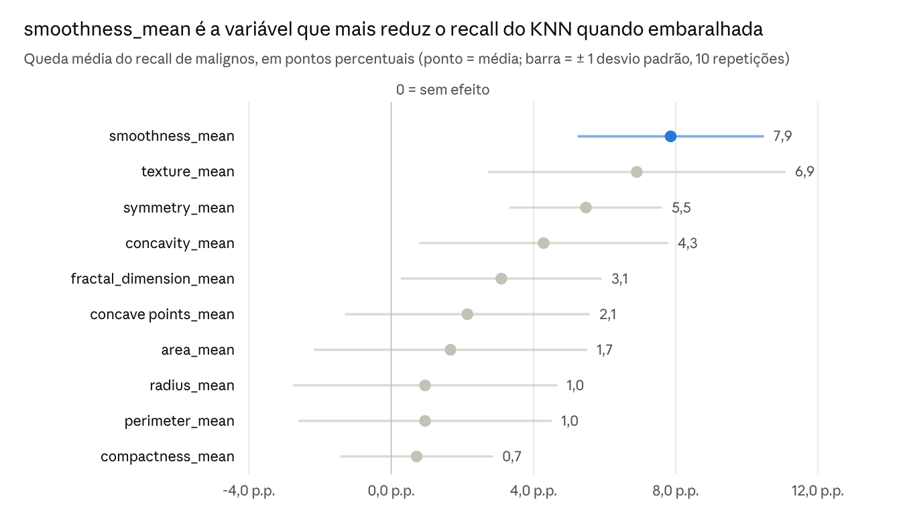

# Relatório Técnico — Classificação de Câncer de Mama com KNN, SVM e Random Forest

23/10/2026 · Hugo César Coelho de Oliveira · Anna Beatriz de Araujo Bonfim · Guilherme Aguiar de Oliveira Junior · Igor Katzer de Sá · Thiago Romão Monteiro Pacheco Prado

## Introdução

O KNN (k = 5) e o SVM linear acertaram 92,1% dos casos de teste (105 de 114 tumores); o Random Forest acertou 88,6%. O KNN é o recomendado, por encontrar mais casos de câncer: 36 de 42 malignos.

Depois, com um conjunto de validação separado e as 30 variáveis, o SVM linear (C = 1) passou a ser o recomendado: 95,3% de acurácia e 2 falsos negativos em 32 malignos, num teste de 86 exames (seção "Validação, 30 variáveis e SHAP").

O trabalho é o Tech Challenge da Fase 1 da pós-graduação IA para DEVs (FIAP). O objetivo é apoiar o diagnóstico de câncer de mama com um classificador binário: maligno (M) ou benigno (B).

Os dados vêm do [Breast Cancer Wisconsin (Diagnostic)](https://www.kaggle.com/datasets/uciml/breast-cancer-wisconsin-data). São 569 exames, 357 benignos (62,7%) e 212 malignos (37,3%). Cada exame tem 30 medidas do núcleo celular, extraídas de imagens de punção aspirativa por agulha fina. O código está no [repositório do projeto](https://github.com/hugocesarcoelho/fiap-tc-fase1-ai).

## Estratégias de pré-processamento

Os dados vieram limpos: só foi preciso escolher colunas, codificar o alvo, dividir treino e teste e padronizar a escala.

1. **Seleção de variáveis.** Cada medida aparece em três versões: média (`_mean`), erro padrão (`_se`) e pior valor (`_worst`). Mantivemos só as 10 médias. As versões `_worst` são muito correlacionadas com as médias, e as `_se` medem variação, não tamanho ou forma. Com menos colunas, o KNN sofre menos com dimensão alta e o modelo fica mais fácil de explicar.
2. **Valores ausentes.** A matriz do `missingno` e o `isnull().sum()` mostraram zero ausentes nas medidas. A única coluna vazia, `Unnamed: 32` (569 nulos), é um artefato do CSV e foi removida, junto com o `id`, que não tem valor preditivo. Também não há exames duplicados, valores negativos nem rótulos fora de M e B. Os 13 exames com concavidade zero são todos benignos, com o zero nas colunas de concavidade e de pontos côncavos ao mesmo tempo: indicam contorno liso, não dado faltando, e foram mantidos.
3. **Codificação do alvo.** `diagnosis` virou numérica: maligno = 1, benigno = 0. Assim a classe positiva é a doença, e o recall mede quantos casos de câncer o modelo encontra.
4. **Divisão treino/teste.** 80% para treino (455 exames) e 20% para teste (114), com `stratify=y` e `random_state=7`. A estratificação mantém a proporção de cerca de 37% de malignos nas duas partes: 170 de 455 no treino e 42 de 114 no teste.
5. **Padronização.** `StandardScaler` deixa cada variável com média 0 e desvio 1. Sem isso, `area_mean` (centenas a milhares) dominaria a distância do KNN sobre `smoothness_mean` (cerca de 0,1). O scaler foi ajustado só no treino e depois aplicado ao teste, para evitar vazamento de dados.

A análise exploratória (boxplots, histograma, swarmplot e pairplot) orientou essas escolhas. Ela mostrou que tumores malignos têm área e concavidade maiores, enquanto a simetria quase não separa os grupos.

## Modelos usados e por quê

Comparamos três classificadores de natureza diferente: um baseado em vizinhança (KNN), um em fronteira linear (SVM) e um conjunto de árvores de decisão (Random Forest). KNN e SVM usaram os dados padronizados. O Random Forest usou os dados originais, porque árvores não dependem da escala.

| Modelo | Configuração | Por que foi escolhido |
| --- | --- | --- |
| KNN (`KNeighborsClassifier`) | k = 5, distância euclidiana | Simples e sem suposição sobre a forma dos dados. Classifica pelo diagnóstico dos 5 exames mais parecidos, o que é fácil de explicar. Funciona bem com poucas variáveis contínuas já padronizadas. |
| SVM linear (`LinearSVC`) | C = 1 | O pairplot mostrou que as classes se separam razoavelmente por uma fronteira (área e concavidade altas = maligno). O SVM busca a fronteira de maior margem e costuma generalizar bem em bases pequenas como esta (455 exames de treino). |
| Random Forest (`RandomForestClassifier`) | 100 árvores, `random_state=42` | Capta relações não lineares e interações entre variáveis sem exigir padronização. Por combinar muitas árvores, é robusto a ruído e tem uma importância de variáveis própria, que serve de contraponto à do KNN. |

**Escolha do k.** Testamos k de 1 a 9 e medimos a taxa de erro no teste. O erro cai de 9,6% (k = 1) para 7,9% em k = 3, 4 e 5, sobe para 8,8% em k = 6 e volta a 7,9% de k = 7 a 9. Escolhemos k = 5, dentro da faixa de erro mínimo: um k ímpar evita empate entre as duas classes, e um k maior reduz a sensibilidade a exames atípicos.

Além do k do KNN, nenhum hiperparâmetro foi ajustado: o `C` do SVM e o número de árvores do Random Forest ficaram nos valores padrão.

## Resultados e interpretação

KNN e SVM empataram em acurácia (92,1%), mas o KNN encontrou um câncer a mais: recall de 85,7% contra 83,3% do SVM. O Random Forest ficou em último nas duas métricas, com 88,6% de acurácia e 76,2% de recall.

| Métrica (teste, 114 exames) | KNN (k = 5) | SVM linear | Random Forest |
| --- | --- | --- | --- |
| Acurácia | 92,1% | 92,1% | 88,6% |
| Recall de malignos | 85,7% (36 de 42) | 83,3% (35 de 42) | 76,2% (32 de 42) |
| Precisão de malignos | 92,3% | 94,6% | 91,4% |
| F1 de malignos | 0,889 | 0,886 | 0,831 |
| Falsos negativos (maligno previsto como benigno) | 6 | 7 | 10 |
| Falsos positivos (benigno previsto como maligno) | 3 | 2 | 3 |

Todos os números vêm do notebook: a acurácia de cada modelo e, na célula de comparação, a matriz de confusão e o relatório de classificação dos três.

**Por que o recall importa mais que a acurácia.** Num exame de triagem, um falso negativo manda para casa uma paciente com câncer; um falso positivo gera um exame a mais. Por isso o KNN é o modelo preferido aqui: tem a mesma acurácia do SVM e o maior recall dos três. Ainda assim, 6 de 42 malignos escapam, e esse é o principal ponto a melhorar.

**Por que o Random Forest ficou atrás.** Com 455 exames de treino e 10 variáveis bem correlacionadas, ele não teve vantagem sobre fronteiras mais simples. O modelo concentrou a importância em medidas de contorno e tamanho: `concave points_mean` (30%), `concavity_mean` (18%) e `perimeter_mean` (17%). Sem ajuste de hiperparâmetros nem do limiar de decisão, foi o mais conservador ao prever maligno: 10 falsos negativos, contra 6 do KNN.

*Notebook, célula de permutation importance (scoring = recall, 10 repetições) · conjunto de teste, 114 exames*

**Importância das variáveis.** No KNN, a importância foi medida por permutação: embaralha-se uma variável e mede-se quanto o recall cai. Textura e forma da célula (suavidade, textura, simetria) pesam mais que tamanho.

Isso parece contradizer a correlação: `concave points_mean` (0,78), `perimeter_mean` (0,74) e `radius_mean` (0,73) são as mais correlacionadas com o diagnóstico. A explicação é a redundância. Raio, perímetro e área medem quase a mesma coisa, então embaralhar uma delas pouco muda, porque as outras compensam. Os desvios são grandes: em 5 das 10 variáveis a barra cruza o zero, e nenhuma sozinha é decisiva.

**Análise exploratória.** Os gráficos confirmam o que os modelos aprenderam. Malignos têm `area_mean` e `concavity_mean` claramente maiores, e o par área × concavidade separa bem os grupos no pairplot. Já `symmetry_mean` tem forte sobreposição entre as classes. As estatísticas descritivas mostram o mesmo: a média de `area_mean` dos malignos é o dobro da dos benignos (978 contra 463), a de `concavity_mean` é 3,5 vezes maior, e `fractal_dimension_mean` tem a mesma média nas duas classes.

## Validação, 30 variáveis e SHAP

Esta parte vem do notebook `02-validacao-shap.ipynb`. Nele ajustamos os hiperparâmetros sem olhar o teste, testamos as variáveis `_worst` e `_se` e incluímos a interpretação com SHAP pedida no enunciado. As versões das dependências foram fixadas no `requirements.txt`, e o `Dockerfile` sobe o Jupyter com tudo instalado (instruções no README).

### Validação e 30 variáveis

No notebook principal, o `k` do KNN foi escolhido pela taxa de erro no teste, o que deixa a métrica final otimista. Desta vez dividimos a base em treino (398 exames), validação (85) e teste (86), com `stratify` e `random_state=7`, e escolhemos os hiperparâmetros pelo maior recall de malignos na validação: `k` de 1 a 15 no KNN, `C` em {0,01; 0,1; 1; 10} no SVM linear e 100 ou 300 árvores, com `class_weight` padrão ou `balanced`, no Random Forest. A padronização ficou dentro do `Pipeline`, ajustada só no treino. Rodamos tudo com as 10 medidas `_mean` e com as 30.

| Variáveis | Modelo | Configuração (validação) | Acurácia | Recall malignos | Precisão | F1 | FN | FP |
|---|---|---|---|---|---|---|---|---|
| 10 (`_mean`) | KNN | k = 5 | 90,7% | 90,6% | 85,3% | 0,879 | 3 | 5 |
| 10 (`_mean`) | SVM linear | C = 0,1 | 91,9% | 84,4% | 93,1% | 0,885 | 5 | 2 |
| 10 (`_mean`) | Random Forest | 100 árvores | 87,2% | 78,1% | 86,2% | 0,820 | 7 | 4 |
| 30 (todas) | KNN | k = 3 | 95,3% | 90,6% | 96,7% | 0,935 | 3 | 1 |
| **30 (todas)** | **SVM linear** | **C = 1** | **95,3%** | **93,8%** | **93,8%** | **0,938** | **2** | **2** |
| 30 (todas) | Random Forest | 100 árvores | 90,7% | 81,2% | 92,9% | 0,867 | 6 | 2 |

Teste com 86 exames (32 malignos). Os números não se comparam diretamente aos da seção anterior, que usou 114.

Com 10 variáveis, o KNN escolheu `k = 5` de novo, então a conclusão do notebook principal se mantém. Com 30, todos os modelos melhoram, o que nos surpreendeu. Tínhamos descartado as `_worst` por parecerem redundantes com as médias, mas elas registram o pior valor de cada característica, e um tumor com um núcleo muito irregular pode ter média próxima à de um benigno. O SVM linear com 30 variáveis é o melhor modelo, com 2 falsos negativos em 32 malignos. Ele chegou a 100% na validação e 95,3% no teste, diferença esperada com 85 exames de validação. O Random Forest ficou atrás nos dois cenários.

### SHAP

Usamos `TreeExplainer` no Random Forest e `LinearExplainer` no SVM linear, sobre os dados padronizados. As variáveis de maior impacto combinam tamanho (`radius_worst`, `area_worst`, `perimeter_worst`) e irregularidade do contorno (`concave points_mean`, `concavity_worst`, `compactness_mean`), e metade delas é `_worst`. Em relação à importância por permutação e por impureza da seção anterior, o SHAP mostra também a direção do efeito: valores altos empurram para maligno.

No SVM, `compactness_mean` alta empurra para benigno. Não é que tumores compactos sejam benignos: `concavity` e `concave points` já capturam a irregularidade do contorno, e o coeficiente de `compactness` compensa o excesso, efeito comum de colinearidade em modelos lineares. No gráfico waterfall de um exame maligno, a decisão vem de várias medidas somadas, principalmente raio, área e pontos côncavos.

Figuras em `docs/figuras/`: `comparacao-10-vs-30.png`, `matriz-confusao-svm.png`, `shap-random-forest.png`, `shap-svm.png`, `shap-exame-individual.png`.

## Conclusão e próximos passos

Com as 10 medidas médias e a divisão original, o KNN (k = 5) chega a 92,1% de acurácia e 85,7% de recall. Com validação separada e as 30 medidas, o modelo recomendado passa a ser o SVM linear (C = 1), com 95,3% de acurácia, 93,8% de recall e 2 falsos negativos em 32 malignos no teste. A decisão se apoia em tamanho e irregularidade do contorno, com bastante peso das medidas `_worst`.

Mesmo o melhor modelo deixa malignos escaparem, e na triagem um falso negativo custa muito mais que um falso positivo. Por isso o modelo serve para priorizar exames, não para diagnosticar. Daqui em diante, falta ajustar o limiar de decisão a favor do recall e usar validação cruzada estratificada para reduzir a variância das métricas, já que com 86 exames de teste cada erro move a acurácia em 1,2 ponto. Antes de qualquer uso real, também seria preciso validar com dados de outros hospitais e equipamentos, porque os 569 exames vêm de uma única fonte.
