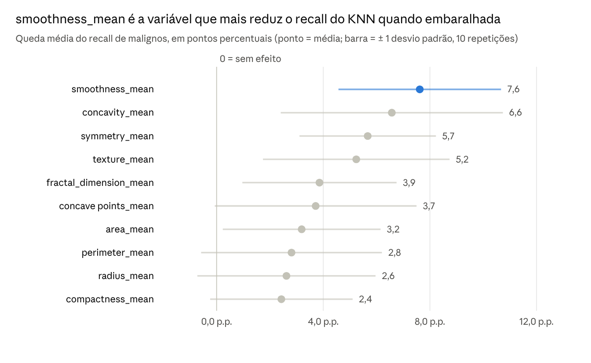

# Relatório Técnico — Classificação de Câncer de Mama com KNN e SVM

23/10/2026 · Hugo César Coelho de Oliveira

## Introdução

O KNN (k = 5) e o SVM linear acertaram 92,1% dos casos de teste: 105 de 114 tumores classificados corretamente como malignos ou benignos.

O trabalho é o Tech Challenge da Fase 1 da pós-graduação IA para DEVs (FIAP). O objetivo é apoiar o diagnóstico de câncer de mama com um classificador binário: maligno (M) ou benigno (B).

Os dados vêm do [Breast Cancer Wisconsin (Diagnostic)](https://www.kaggle.com/datasets/uciml/breast-cancer-wisconsin-data). São 569 exames, 357 benignos (62,7%) e 212 malignos (37,3%). Cada exame tem 30 medidas do núcleo celular, extraídas de imagens de punção aspirativa por agulha fina. O código está no [repositório do projeto](https://github.com/hugocesarcoelho/fiap-tc-fase1-ai).

## Estratégias de pré-processamento

Os dados vieram limpos: só foi preciso escolher colunas, codificar o alvo, dividir treino e teste e padronizar a escala.

1. **Seleção de variáveis.** Cada medida aparece em três versões: média (`_mean`), erro padrão (`_se`) e pior valor (`_worst`). Mantivemos só as 10 médias. As versões `_worst` são muito correlacionadas com as médias, e as `_se` medem variação, não tamanho ou forma. Com menos colunas, o KNN sofre menos com dimensão alta e o modelo fica mais fácil de explicar.
2. **Valores ausentes.** A matriz do `missingno` e o `isnull().sum()` mostraram zero ausentes nas medidas. A única coluna vazia, `Unnamed: 32` (569 nulos), é um artefato do CSV e foi removida, junto com o `id`, que não tem valor preditivo.
3. **Codificação do alvo.** `diagnosis` virou numérica: maligno = 1, benigno = 0. Assim a classe positiva é a doença, e o recall mede quantos casos de câncer o modelo encontra.
4. **Divisão treino/teste.** 80% para treino (455 exames) e 20% para teste (114), com `stratify=y` e `random_state=7`. A estratificação mantém a proporção de cerca de 37% de malignos nas duas partes: 170 de 455 no treino e 42 de 114 no teste.
5. **Padronização.** `StandardScaler` deixa cada variável com média 0 e desvio 1. Sem isso, `area_mean` (centenas a milhares) dominaria a distância do KNN sobre `smoothness_mean` (cerca de 0,1). O scaler foi ajustado só no treino e depois aplicado ao teste, para evitar vazamento de dados.

A análise exploratória (boxplots, histograma, swarmplot e pairplot) orientou essas escolhas. Ela mostrou que tumores malignos têm área e concavidade maiores, enquanto a simetria quase não separa os grupos.

## Modelos usados e por quê

Comparamos dois classificadores de natureza diferente: um baseado em vizinhança (KNN) e um baseado em fronteira linear (SVM). Ambos rodaram sobre os mesmos dados padronizados.

| Modelo | Configuração | Por que foi escolhido |
| --- | --- | --- |
| KNN (`KNeighborsClassifier`) | k = 5, distância euclidiana | Simples e sem suposição sobre a forma dos dados. Classifica pelo diagnóstico dos 5 exames mais parecidos, o que é fácil de explicar. Funciona bem com poucas variáveis contínuas já padronizadas. |
| SVM linear (`LinearSVC`) | C = 1 | O pairplot mostrou que as classes se separam razoavelmente por uma fronteira (área e concavidade altas = maligno). O SVM busca a fronteira de maior margem e costuma generalizar bem em bases pequenas como esta (455 exames de treino). |

**Escolha do k.** Testamos k de 1 a 9 e medimos a taxa de erro no teste. O erro cai de 9,6% (k = 1) para 7,9% a partir de k = 3 e fica estável. Escolhemos k = 5, no meio da faixa estável: um k ímpar evita empate entre as duas classes, e um k maior reduz a sensibilidade a exames atípicos.

O notebook não treinou Random Forest, apesar do nome do arquivo. O `C` do SVM também não foi ajustado.

## Resultados e interpretação

Os dois modelos empataram em acurácia (92,1%), mas o KNN encontrou um câncer a mais: recall de 85,7% contra 83,3% do SVM.

| Métrica (teste, 114 exames) | KNN (k = 5) | SVM linear |
| --- | --- | --- |
| Acurácia | 92,1% | 92,1% |
| Recall de malignos | 85,7% (36 de 42) | 83,3% (35 de 42) |
| Precisão de malignos | 92,3% | 94,6% |
| F1 de malignos | 0,889 | 0,886 |
| Falsos negativos (maligno previsto como benigno) | 6 | 7 |
| Falsos positivos (benigno previsto como maligno) | 3 | 2 |

O notebook imprime só a acurácia. Recall, precisão, F1 e matriz de confusão foram recalculados com a mesma divisão (`random_state=7`) e os mesmos modelos.

**Por que o recall importa mais que a acurácia.** Num exame de triagem, um falso negativo manda para casa uma paciente com câncer; um falso positivo gera um exame a mais. Por isso o KNN é o modelo preferido aqui, mesmo com a mesma acurácia. Ainda assim, 6 de 42 malignos escapam, e esse é o principal ponto a melhorar.

*Notebook, célula de permutation importance (scoring = recall, 10 repetições) · conjunto de teste, 114 exames*

**Importância das variáveis.** A importância foi medida por permutação: embaralha-se uma variável e mede-se quanto o recall cai. Textura e forma da célula (suavidade, concavidade, simetria) pesam mais que tamanho.

Isso parece contradizer a correlação: `concave points_mean` (0,78), `perimeter_mean` (0,74) e `radius_mean` (0,73) são as mais correlacionadas com o diagnóstico. A explicação é a redundância. Raio, perímetro e área medem quase a mesma coisa, então embaralhar uma delas pouco muda, porque as outras compensam. Os desvios são grandes: em 4 das 10 variáveis a barra cruza o zero, e nenhuma sozinha é decisiva.

**Análise exploratória.** Os gráficos confirmam o que os modelos aprenderam. Malignos têm `area_mean` e `concavity_mean` claramente maiores, e o par área × concavidade separa bem os grupos no pairplot. Já `symmetry_mean` tem forte sobreposição entre as classes.

## Conclusão e próximos passos

Com só 10 medidas médias e padronização, o KNN (k = 5) chega a 92,1% de acurácia e 85,7% de recall. É o modelo recomendado entre os dois testados. Por deixar escapar 6 de 42 malignos, ele serve como apoio à triagem, não como substituto do diagnóstico médico.

- Usar validação cruzada estratificada: com 114 exames de teste, cada erro move a acurácia em 0,9 ponto.
- Ajustar hiperparâmetros (k e pesos do KNN, `C` do SVM) com `GridSearchCV`, otimizando o recall.
- Testar as variáveis `_worst` e `_se` hoje descartadas.
- Treinar o Random Forest que o nome do notebook promete e comparar com os dois modelos atuais.
